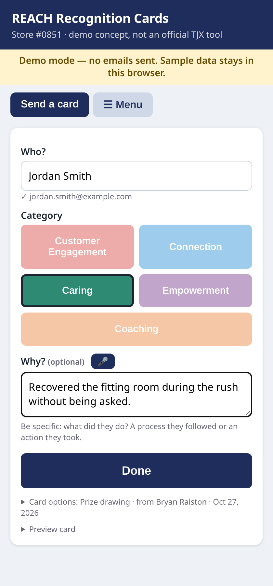
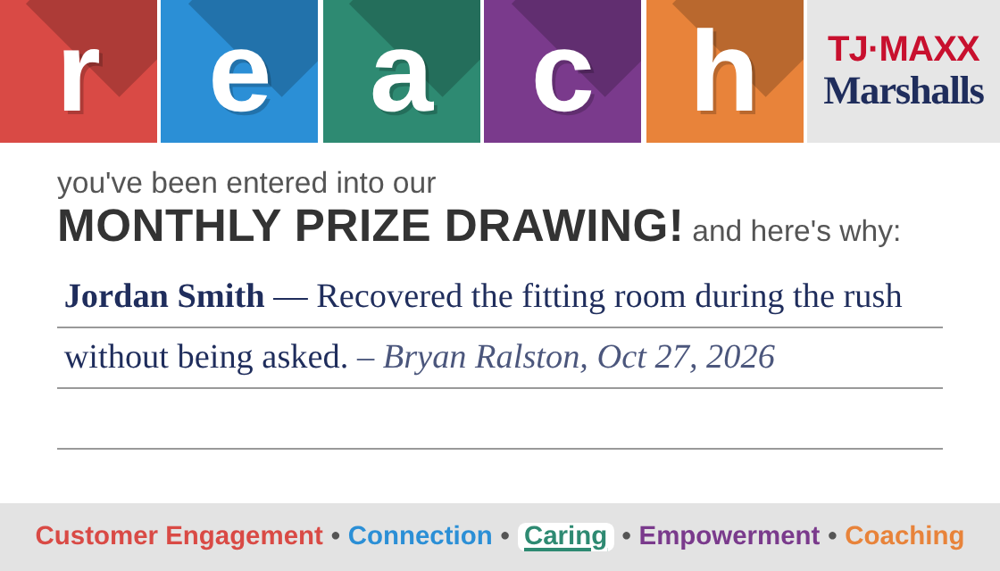
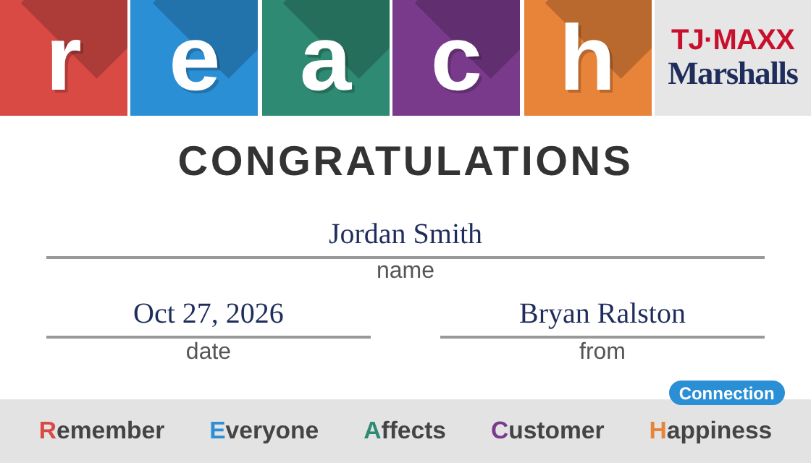

# REACH Recognition Cards

**Recognize an associate in under 10 seconds.** Type a name, tap a REACH value, add an optional "why" (or say it), press **Send**. The associate gets their card, and they're automatically entered in that month's raffle for that value. At month end the app draws one winner per value and notifies them.

> Demo concept built by Bryan Ralston (Store #0851). **Not an official TJX tool.** No real employee data is in this repo.

**Try the demo:** https://bryanralston.github.io/reach-cards/ (runs entirely in your browser with sample data, nothing is sent)  
**Full app (passcode protected):** https://reach-cards.vercel.app

| Main screen | Prize drawing card | Congratulations card |
|---|---|---|
|  |  |  |

## What it does
- **Both REACH card types:** Prize drawing (default, with "here's why") and Congratulations (a small toggle). Covers the 5 values: Customer Engagement, Connection, Caring, Empowerment, Coaching.
- **Fewest taps:** name autocompletes from the employee list, 5 big value buttons, optional message with 🎤 voice input, one Send button. From and date fill in automatically and are remembered.
- **Sending:** the card image (PNG) plus a short note goes to the associate by WorkJam (once connected) or email.
- **Raffle pools:** every sent card is logged (employee, value, card type, date, from) into that month's pool for its value.
- **Monthly draw:** one winner per value, notified automatically. See below.
- **Employees (☰ Menu):** add one at a time, upload a CSV, or paste rows copied from a spreadsheet. Shows a preview with counts, checks emails, removes duplicates by email. Can also sync from WorkJam.
- Print (single card at 3.5×2 in, or a sheet of 10) and PNG download are still in ☰ Menu.

## How the draw works
- **Entries:** by default **one entry per card received**, so more recognition means more chances. Switch in ☰ Menu to **one entry per person per value**.
- **Randomness:** cryptographically secure (`crypto.randomInt` on the server, `crypto.getRandomValues` with rejection sampling in the demo), with no modulo bias.
- **Audit:** every draw is saved with a timestamp, the mode, the full numbered entry list and the winning entry number.
- **Manual "Draw now"** shows a *preview*. Nobody is notified until you press **Confirm & notify winners**.
- **Automatic:** a Vercel cron runs at 14:00 UTC on the 1st of each month. It draws the prior month (skipped if already confirmed), notifies each winner, and emails the winners list to `ADMIN_EMAIL`.

## Architecture
- `index.html` + `app.js`: the single front end. On GitHub Pages it runs in **demo mode** (localStorage). On Vercel it uses the API.
- `app/api/*`: Next.js route handlers (login, employees, send, entries, draw, settings, directory, status, cron).
- Storage: Vercel Blob (private), JSON docs `employees.json`, `entries/YYYY-MM.json`, `draws/YYYY-MM.json`.
- `lib/notify.js`, the **Notifier** interface (`sendCard`, `sendWinner`): `WorkJamNotifier` first if configured, falling back to `EmailNotifier` (Resend) if WorkJam isn't configured or a send fails. The demo uses a simulated notifier.
- `lib/directory.js`, the **EmployeeDirectory**: `WorkJamDirectory` (read and sync; writes only if explicitly enabled) and local storage (default).

### WorkJam status (unverified)
WorkJam doesn't publish its API docs (docs.workjam.com requires a login, and API access goes through customers or partners). The WorkJam code here is a **configurable stub**. You supply the endpoint paths, and it assumes OAuth2 client credentials. The payload and field mapping must be checked against WorkJam's real docs before use. Employee records can hold an optional `workjamId` and `employeeId` (HR ID). Writing employees to WorkJam is **off** by default, because profiles usually come from the HR system (Workday/UKG).

## Deploy
1. `vercel link`, then `vercel blob create-store reach-cards-data --access private --yes`
2. Environment variables:
   - Required: `ADMIN_PASSCODE`, `CRON_SECRET`
   - Email: `RESEND_API_KEY`, `EMAIL_FROM` (a verified sender domain), `ADMIN_EMAIL`, optional `EMAIL_DRY_RUN=1`, optional `TEST_EMAIL`
   - WorkJam (optional): `WORKJAM_BASE_URL`, `WORKJAM_CLIENT_ID`, `WORKJAM_CLIENT_SECRET`, `WORKJAM_TOKEN_URL`, `WORKJAM_NOTIFY_PATH`, `WORKJAM_EMPLOYEES_PATH`, `WORKJAM_EMPLOYEES_WRITE=1`, `NOTIFIER=auto|workjam|email`
3. `vercel deploy --prod`

Without email or WorkJam credentials, the app runs in **record-only** mode. Cards are logged and the raffle works, but nothing is sent.
